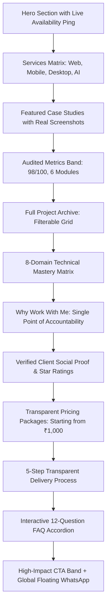

<div align="center">

  

  <br />
  <br />

  # ⚡ Gangadhara Gooti
  ### **Freelance Full-Stack Developer & Technical Solutions Consultant**

  <p align="center">
    <i>"Building software that feels simple on the surface, engineered deeply underneath."</i>
  </p>

  <p align="center">
    <a href="https://wa.me/916300355608" target="_blank">
      
    </a>
    <a href="mailto:contact.vektorsynapse@gmail.com">
      
    </a>
    <a href="https://linkedin.com/in/gangadhar-gooti" target="_blank">
      
    </a>
    <a href="https://github.com/vektorsynapse" target="_blank">
      
    </a>
  </p>

  <p align="center">
    
    
    
    
    
    
  </p>

</div>

---

## 🔮 Overview

This repository powers the official portfolio and digital client acquisition platform for **Gangadhara Gooti**. Designed with a bespoke **Apple/Linear-inspired dark glassmorphism aesthetic**, it serves as living proof of engineering discipline, speed, and clean code architecture.

Unlike generic developer portfolios, this system is built as a **high-converting client engagement engine** featuring real-time multi-currency pricing calculations, verified client reviews from Indian and European deployments, Edge-generated OpenGraph previews, and interactive project case studies.

---

## 📊 Key Highlights & Audited Metrics

```
  ┌───────────────────────┬────────────────────────┬────────────────────────┬───────────────────────┐
  │   8 Client Projects   │    98/100 PageSpeed    │  6 Real-Time Modules   │    5 Public Demos     │
  │ India, Ireland, Global│   0.00 CLS Performance │ Zyrone Energy (Flutter)│  Open-Source & Tested │
  └───────────────────────┴────────────────────────┴────────────────────────┴───────────────────────┘
```

* **Zero-Shift Geometry:** Rigorously engineered layout geometry hitting **0.00 Cumulative Layout Shift (CLS)** and sub-second Largest Contentful Paint (LCP).
* **Edge-Native Social Sharing:** Dynamic OpenGraph preview images rendered on-the-fly via Next.js Edge Runtime (`ImageResponse`).
* **Multi-Currency Pricing Calculator:** Instant real-time conversion across **INR (₹)**, **USD ($)**, and **EUR (€)** with formatted ranges.
* **Frictionless Lead Routing:** Server-side contact API featuring instant WhatsApp routing, direct email fallback, and optional Resend/Web3Forms webhook delivery.

---

## 🏗️ Architecture & Core Sections



### 🎯 Feature Breakdown

| Feature | Tech Implementation | Purpose |
|---|---|---|
| **🎨 3D Emblem Floating Brand** | Custom cropped 1024x1024 lossless PNG, micro-tilt springs | Unboxed, native brand presence across header & footer |
| **💬 Global WhatsApp Widget** | Motion spring entry, auto-timed dismissible tooltip | Instant 1-click consultation with pre-filled scope prompts |
| **💰 Approachable Pricing** | Real-time currency rates with range and `+` parsing | Lowers client onboarding friction starting at ₹1,000 |
| **⭐ Social Proof Engine** | Structured testimonials linked directly to project slugs | Verified proof from Ireland, India, and enterprise clients |
| **🗺️ Search Engine Engine** | Dynamic `sitemap.ts` & `robots.ts` with metadataBase | Automated crawler discovery for all 13 project case studies |
| **📄 1-Click PDF Resume** | Served directly via local static storage `/resume/` | Zero login barriers or Google Drive authorization prompts |

---

## 🛠️ Technology Stack

<table align="center" width="100%">
  <tr>
    <td align="center" width="25%">
      <b>Frontend Experience</b>
      <br /><br />
      • <b>Next.js 16.4</b> (App Router)<br />
      • <b>React 19</b> & Server Components<br />
      • <b>Tailwind CSS v4</b> (CSS Variables)<br />
      • <b>Motion (Framer)</b> Springs<br />
      • <b>Lucide Icons</b> & Base UI
    </td>
    <td align="center" width="25%">
      <b>Backend & Core Logic</b>
      <br /><br />
      • <b>Node.js</b> & <b>NestJS</b><br />
      • <b>TypeScript 5.7</b> Strict Mode<br />
      • <b>Zod</b> Runtime Validation<br />
      • <b>Resend</b> / <b>Web3Forms</b> API<br />
      • Edge Runtime <code>ImageResponse</code>
    </td>
    <td align="center" width="25%">
      <b>Multi-Platform Capability</b>
      <br /><br />
      • <b>Flutter & Dart</b> (iOS & Android)<br />
      • <b>Electron & Tauri</b> (Desktop)<br />
      • <b>SQLite & MongoDB</b><br />
      • <b>Firebase Realtime</b> & FCM<br />
      • WebSockets State Sync
    </td>
    <td align="center" width="25%">
      <b>DevOps & Quality</b>
      <br /><br />
      • <b>Vercel Edge</b> Deployment<br />
      • <b>Lighthouse CI</b> (90+ Scores)<br />
      • Git Clean Versioning<br />
      • <b>JSON-LD</b> Rich Snippets<br />
      • Automated XML Sitemaps
    </td>
  </tr>
</table>

---

## 💼 Featured Case Studies Showcased

<details open>
<summary><b>1. Zyrone Energy — Field Operations Mobile Transformation</b></summary>
<br />

* **Platform:** Flutter Mobile App + NestJS REST Backend + Firebase
* **Client:** Industrial Energy Firm (Gujarat, India)
* **Outcome:** Digitized 6 operational field modules, eliminating manual phone logs and paperwork to give dispatch leads sub-second visibility into field teams.
</details>

<details open>
<summary><b>2. Comfort Floors & Bathrooms — International Web Storefront</b></summary>
<br />

* **Platform:** Next.js 14, TypeScript, Tailwind CSS
* **Client:** Premium Home Renovation Business (Ireland)
* **Audited Metric:** **98/100 Google PageSpeed** with **0.00 CLS**
* **Live Site:** [comfortfloors.ie](https://comfortfloors.ie/)
</details>

<details open>
<summary><b>3. Medcare — Offline Desktop Clinic & Pharmacy Billing</b></summary>
<br />

* **Platform:** Electron, React, Node.js, SQLite
* **Deployment:** Signed Windows Installer in active daily counter use
* **Challenge:** Zero cloud reliance; required instant item lookups and thermal receipt printing during peak rush hours without internet connectivity.
</details>

<details>
<summary><b>4. Sayed 3D Digital Invitation — Interactive WebGL Experience</b></summary>
<br />

* **Platform:** Three.js, GSAP, Lenis, HarfBuzz font shaping, Vite
* **Highlight:** Zero-JS accessible fallback with 61 automated unit tests and WhatsApp guest routing.
</details>

---

## 📁 Repository Structure

```
gangadhara-gooti-portfolio/
├── app/
│   ├── about/             # Detailed career background & certifications
│   ├── api/contact/       # Serverless email & lead dispatch handler
│   ├── contact/           # Multi-channel client communication portal
│   ├── work/              # Project gallery & [slug] dynamic case studies
│   ├── globals.css        # Tailwind v4 theme tokens & glass styling
│   ├── layout.tsx         # Root layout with metadataBase & providers
│   ├── opengraph-image.tsx# Dynamic Edge OpenGraph card generator
│   ├── page.tsx           # Homepage composing 12 conversion sections
│   ├── robots.ts          # Search engine crawler directives
│   └── sitemap.ts         # Automated XML sitemap indexer
├── components/
│   ├── brand-icons.tsx    # Optimized vector brand logos
│   ├── contact-form.tsx   # Validated lead intake with instant routing
│   ├── cta-band.tsx       # Global conversion banner
│   ├── faq.tsx            # Animated 12-question accordion with category filter
│   ├── featured-work.tsx  # Flagship client project spotlight
│   ├── hero.tsx           # Interactive hero with live status beacon
│   ├── how-we-work.tsx    # 5-step transparent delivery pipeline
│   ├── pricing.tsx        # Dynamic 3-tier multi-currency pricing matrix
│   ├── project-card.tsx   # Tilt-interactive cards with real screenshots
│   ├── site-header.tsx    # Navigation with clean floating logo
│   ├── testimonials.tsx   # Social proof & verified ratings
│   └── whatsapp-button.tsx# Global floating instant-chat action widget
├── lib/
│   ├── data/              # Decoupled content: profile, projects, services, faq, pricing
│   └── contact-schema.ts  # Strict Zod validation rules
└── public/
    ├── images/            # Real project UI screenshots & high-res clean logo
    └── resume/            # Direct download PDF resume
```

---

## 🚀 Getting Started

### Prerequisites
* **Node.js** 20.x or higher
* **pnpm** (recommended) or **npm**

### Installation

1. **Clone the repository:**
   ```bash
   git clone https://github.com/Gangadhar-gdvs/gangadhara-gooti-portfolio.git
   cd gangadhara-gooti-portfolio
   ```

2. **Install dependencies:**
   ```bash
   npm install
   # or
   pnpm install
   ```

3. **Configure Environment Variables (Optional):**
   Create a `.env.local` file in the root directory:
   ```env
   # Optional: For automated email delivery from the contact form
   RESEND_API_KEY=re_your_api_key_here
   # Or Web3Forms:
   WEB3FORMS_ACCESS_KEY=your_access_key_here

   # Site URL for metadata & sitemap resolution
   NEXT_PUBLIC_SITE_URL=https://gangadhara-gooti.vercel.app
   ```

4. **Run development server:**
   ```bash
   npm run dev
   ```
   Open [http://localhost:3000](http://localhost:3000) in your browser.

5. **Build for production:**
   ```bash
   npm run build
   npm run start
   ```

---

## 📬 Contact & Availability

I am currently **open for new freelance engagements**, end-to-end MVP builds, technical consulting, and retainer partnerships.

* 🌐 **Portfolio:** [gangadhara-freelancer.vercel.app](https://gangadhara-freelancer.vercel.app)
* 💬 **WhatsApp:** [+91 6300355608](https://wa.me/916300355608)
* ✉️ **Email:** [gangadhargdvs0@gmail.com](mailto:gangadhargdvs0@gmail.com)
* 💼 **LinkedIn:** [/in/gangadhar-gooti](https://linkedin.com/in/gangadhar-gooti)
* 📍 **Location:** Madhapur, Hyderabad, India *(Operates globally with IST / GMT / EST overlap)*

---

<div align="center">
  <sub>Designed & engineered with precision by <b>Gangadhara Gooti</b>. Licensed under the MIT License.</sub>
</div>
